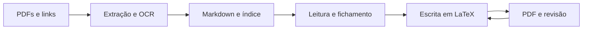

<div align="center">

# Escrita agêntica · UTFPR

**Das leituras ao PDF, com fontes rastreáveis e versões que você pode comparar.**

Uma base de escrita acadêmica que reúne Python, Markdown, LaTeX e Git,
com um agente cuidando da preparação e das operações técnicas.

[Começar](#seu-primeiro-pedido) · [Experimentar em grupo](#uma-oficina-em-duas-atividades) · [Instruções para agentes](AGENTS.md)

</div>

---

Você traz uma pergunta, suas leituras e uma direção para o texto. O agente prepara o ambiente, organiza as fontes, trabalha nos arquivos e gera o PDF. As decisões sobre recorte, interpretação e argumento continuam com você.

O resultado fica no projeto: fontes identificadas, notas de leitura, texto editável e um histórico de versões. As [regras de trabalho](AGENTS.md) também ficam registradas, para que você não precise repetir suas orientações a cada pedido.

**Abra somente o que precisar.**

| Sua situação | Por onde seguir |
| --- | --- |
| Já está tudo preparado | Vá direto para as [atividades da oficina](#uma-oficina-em-duas-atividades). |
| Precisa configurar ou obter o projeto | Abra a opção correspondente em [Começar](#seu-primeiro-pedido). |
| Quer guardar o trabalho no GitHub | Veja [repositório privado e SSH](#guardar-o-trabalho-no-github). |

## Seu primeiro pedido

Se não conseguir preparar tudo antes, **posso ajudar rapidamente nas configurações durante o encontro**.

### 1. Conecte um agente

Se o seu agente já funciona no VS Code, pule para **2. Prepare o projeto**. Git, Python, LaTeX e OCR serão preparados por ele.

<details>
<summary><strong>Ainda não tenho um agente: escolher e conectar</strong></summary>

Instale e abra o [Visual Studio Code](https://code.visualstudio.com/download). No painel **Extensões**, instale a extensão oficial da ferramenta escolhida e entre na sua conta.

- **Já usa Codex ou Claude Code?** Continue com sua ferramenta. Não precisa instalar o OpenCode.
- **Sua conta do ChatGPT ou Claude dá acesso a esses agentes?** Instale a extensão oficial do [Codex](https://learn.chatgpt.com/docs/codex/ide) ou do [Claude Code](https://code.claude.com/docs/en/vs-code) e entre com sua conta. Confira o acesso e os limites do seu plano.
- **Quer experimentar sem contratar uma assinatura?** O OpenCode oferece [alguns modelos gratuitos](https://opencode.ai/v2/docs/console/models/), sujeitos a disponibilidade e limites. Escolha um deles; outros modelos e provedores podem ser pagos. Veja a instalação abaixo.

Você só precisa de **um agente funcionando**, capaz de editar arquivos e executar tarefas no projeto.

Para OpenCode, conclua também a instalação do CLI nas opções abaixo. Faça isso antes do encontro; se precisar, peça apoio a quem conduz a oficina.

</details>

<details>
<summary><strong>Vou usar OpenCode: instalar e conferir</strong></summary>

Se já usa Codex ou Claude Code, pode pular esta opção. Se tiver outro agente disponível, peça que ele faça esta preparação conforme [AGENTS.md](AGENTS.md).

Abra somente o guia do seu sistema:

<details>
<summary><strong>Windows</strong></summary>

1. Na [documentação oficial](https://opencode.ai/v2/docs/), vá a **CLI → Windows** e baixe **x64**; para computadores com processador ARM, escolha **ARM64**. Use o CLI, não o instalador do aplicativo desktop.
2. Extraia o arquivo baixado. No Explorador de Arquivos, digite `%LOCALAPPDATA%\Programs` na barra de endereço. Crie a pasta `OpenCodeCLI` e coloque nela o arquivo `opencode.exe` extraído. Copie o endereço completo dessa pasta.
3. No menu Iniciar, pesquise **Editar as variáveis de ambiente da sua conta**. Em **Variáveis de usuário**, selecione **Path → Editar → Novo**, cole o endereço copiado e confirme em **OK**. Não apague os caminhos existentes.

</details>

<details>
<summary><strong>Linux</strong></summary>

No terminal, execute o instalador oficial da v2:

```bash
curl -fsSL https://opencode.ai/v2/install | bash
```

Esse comando usa Bash e não é uma instrução para o PowerShell do Windows. Se o instalador falhar ou o comando não for encontrado depois da instalação, peça apoio para conferir o PATH e a compatibilidade com a distribuição. Não tente resolver instalando uma versão antiga.

</details>

**Concluir nos dois sistemas**

1. No VS Code, abra **Extensões**, procure `sst-dev.opencode` e instale a [extensão OpenCode](https://marketplace.visualstudio.com/items?itemName=sst-dev.opencode). A extensão sozinha não instala o CLI.
2. Feche o terminal antigo pelo ícone da lixeira. Feche e reabra o VS Code, preservando seu trabalho, para que ele receba o PATH atualizado.
3. Abra o OpenCode pelo botão da extensão ou pelo seu atalho. Escolha um modelo identificado como gratuito, conclua a conexão solicitada e envie uma mensagem curta. Insira credenciais somente na interface de autenticação.

**Se aparecer “comando não encontrado” ou abrir uma versão antiga**, avise antes do encontro. Quem auxilia deve conferir qual executável está sendo chamado no terminal do VS Code e corrigir o PATH, preservando as demais configurações. Trocar o atalho não resolve a localização do programa.

Instale a versão estável mais recente indicada pela documentação durante a preparação. A v1 não migra automaticamente para a v2. Após testar abertura, resposta e geração do PDF, mantenha a versão ensaiada durante a oficina. Os procedimentos técnicos e critérios de validação estão em [AGENTS.md](AGENTS.md).

[Instalação oficial](https://opencode.ai/v2/docs/) · [Migração da v1](https://opencode.ai/v2/docs/migrate-v1/).

</details>

### 2. Prepare o projeto

Escolha uma das duas situações:

<details>
<summary><strong>Já abri este projeto no VS Code: conferir o ambiente</strong></summary>

Envie diretamente:

> Leia AGENTS.md e prepare este projeto para escrita. Cuide das instalações e configurações necessárias, confira o funcionamento do OCR e gere o PDF de exemplo. Mostre o resultado e informe se houver alguma pendência.

**Você não precisa executar comandos.** O agente reaproveita as ferramentas disponíveis, instala o necessário e testa o ambiente. Se uma restrição de acesso impedir uma etapa, ele explica o bloqueio específico.

Depois, informe título, autoria e o que pretende escrever. O agente adapta os metadados e substitui os capítulos de exemplo.

</details>

<details>
<summary><strong>Ainda não tenho o projeto: criar uma cópia</strong></summary>

Com o VS Code e o agente funcionando:

1. Crie uma pasta vazia para o trabalho e abra-a no VS Code pela opção **Abrir Pasta / Open Folder** do menu **Arquivo / File**.
2. No painel do agente, envie:

```text
Quero começar um projeto com esta base:
https://github.com/quisen/escrita-agentica-utfpr

Prepare uma cópia na pasta vazia que abri. Verifique o que já está
instalado e cuide de obter o projeto e preparar o ambiente.
Se o Git não estiver instalado, instale-o antes de usá-lo.
Não sobrescreva arquivos existentes nem crie repositórios Git aninhados.

Depois de obter os arquivos, leia AGENTS.md e siga suas instruções.
Instale e configure as ferramentas necessárias, teste a extração e
o OCR, compile o documento de exemplo e me mostre o PDF.
Informe o que ficou pronto e qualquer impedimento concreto.
Não publique nada.
```

Você faz essa conexão inicial com o agente. A partir daí, ele cuida da preparação técnica, incluindo baixar e instalar o Git quando necessário. Login e eventuais permissões solicitadas pelo sistema continuam sendo feitos por você.

</details>

## Uma oficina em duas atividades

### 01 · De uma pergunta a um mapa de evidências

PDF, Python, OCR e Markdown

Compare duas leituras sobre dados e plataformas. Escolha uma afirmação, volte à passagem que a sustenta e decida qual argumento merece ser desenvolvido.

[Ver roteiro e links das leituras →](atividades/01-mapa-de-evidencias.md)

### 02 · Um texto que muda quando o argumento muda

LaTeX, revisão e Git

Transforme o mapa em um miniensaio no template UTFPR. Introduza uma objeção, acompanhe seus efeitos no texto e compare duas versões registradas.

[Ver roteiro →](atividades/02-ensaio-em-revisao.md)

Antes do encontro, peça ao agente para preparar o ambiente, baixar as duas leituras e gerar o PDF de exemplo. Faça isso em cada computador que será usado. Durante as atividades, o grupo acompanha os resultados e toma as decisões de conteúdo, sem precisar operar o terminal.

Os artigos escolhidos têm texto selecionável: a demonstração pode funcionar sem OCR. Ele é um recurso para fontes que precisem dele, não uma etapa obrigatória.

### Leituras para discutir o método

- **Principal:** Pividori e Greene (2024), [*A publishing infrastructure for Artificial Intelligence (AI)-assisted academic authoring*](https://academic.oup.com/jamia/article/31/9/2103/7693927). Revisão de textos com IA, avaliação humana e histórico de alterações.
- **Complementar:** Gueroudji et al. (2025), [*ControlA: Agentic Workflow Control Mechanisms for Reliable Science*](https://rafaelsilva.com/files/publications/gueroudji2025ai4sc.pdf). Proposta conceitual de controle de erros e rastreabilidade em fluxos com agentes.

Esses textos fundamentam a discussão sobre o método. Os artigos usados no exercício de comparação estão indicados na atividade 1.

## Pedidos que viram trabalho nos arquivos

<details>
<summary><strong>Ver exemplos do que pedir ao agente</strong></summary>

| Você pede | O agente faz |
| --- | --- |
| “Incorpore estas leituras ao projeto.” | Obtém os PDFs, verifica a extração, tenta OCR quando necessário e atualiza o índice. |
| “Compare como os dois textos tratam esta questão.” | Prepara uma síntese com passagens de apoio, localização nas fontes e limites da comparação. |
| “Desenvolva esta ideia com base nas leituras conferidas.” | Trabalha no texto LaTeX, mantém as atribuições às fontes e apresenta o PDF atualizado. |
| “Esta conclusão está forte demais para as evidências.” | Revê o argumento e os trechos afetados, mostrando o que mudou. |
| “Registre esta versão.” | Confere as alterações e cria um commit local. Publicação e envio exigem pedido explícito. |

O [índice do corpus](corpus_md/INDEX.md) reúne referências, resumos, palavras-chave e vínculos com a escrita, além do estado de extração e OCR. O agente o mantém atualizado a partir do catálogo.

A extração automática identifica problemas técnicos, mas não certifica uma interpretação. Antes de usar uma passagem, confira seu contexto e a atribuição no original.

</details>

<details>
<summary><strong>Entender o fluxo: das fontes ao PDF</strong></summary>



</details>

## Guardar o trabalho no GitHub

Esta etapa é opcional e pode ficar para depois da oficina.

<details>
<summary><strong>Guardar meu trabalho em um repositório privado no GitHub e conectar por SSH</strong></summary>

Um repositório privado guarda versões do trabalho no GitHub, com acesso restrito a você e às pessoas autorizadas. A conexão SSH permite que o agente envie e obtenha versões usando uma chave deste computador.

### 1. Peça a preparação ao agente

Você precisa de uma conta no [GitHub](https://github.com). Com seu projeto aberto, envie:

```text
Quero guardar este trabalho em um novo repositório PRIVADO na minha
conta do GitHub e configurar a conexão SSH neste computador.

Cuide da instalação e configuração do Git e das ferramentas necessárias.
Pergunte o nome do repositório e os dados de autoria dos commits que
não estiverem configurados. Confira qual conta está autenticada.

Verifique se já há uma chave SSH adequada. Reutilize-a quando possível;
se precisar de outra, crie uma chave Ed25519 fora da pasta do projeto,
sem sobrescrever chaves existentes. Oriente-me a inserir uma frase-senha
diretamente no terminal seguro, sem enviá-la nesta conversa.
Configure o ssh-agent para o sistema usado e teste o acesso ao GitHub.

Oriente-me nas etapas de login e cadastro da chave pública.
Não leia, mostre ou envie a chave privada, senhas ou tokens.

Crie um repositório privado independente, não um fork público.
Preserve o repositório base e outros remotos existentes. Se esta pasta
for a base compartilhada, prepare uma cópia independente para meu trabalho
antes de configurar o destino privado. Não faça push para o projeto base.

Confira a seleção de arquivos, faça o commit inicial se necessário
e envie o trabalho ao novo destino privado por SSH.
Mantenha PDFs de terceiros e extrações integrais fora do Git.
Ao terminar, confira a visibilidade privada, a conta, o remoto de envio
e a correspondência entre o commit local e o do GitHub. Mostre o link.
```

### 2. Faça somente as etapas da sua conta

O agente executa os comandos e informa quando precisa de você. Entre na conta e conclua as confirmações solicitadas no navegador. Senhas, códigos de autenticação e a frase-senha da chave não precisam ser enviados na conversa.

Se o cadastro da chave for manual, o agente pode copiar a **chave pública**, arquivo terminado em `.pub`, para você colar em [GitHub → Settings → SSH and GPG keys → New SSH key](https://github.com/settings/ssh/new). Escolha **Authentication Key**, dê um nome que identifique o computador e confirme. A chave privada fica no computador, fora do projeto. [Instruções oficiais](https://docs.github.com/en/authentication/connecting-to-github-with-ssh/adding-a-new-ssh-key-to-your-github-account).

Se a criação do repositório precisar ser feita pelo navegador, use [New repository](https://github.com/new), escolha o nome e marque **Private**. Para enviar um projeto local já existente, deixe desmarcada a criação de README, licença e `.gitignore` no GitHub. Entregue ao agente apenas o link do repositório criado. Ele faz a conexão e o envio.

### 3. Confira o resultado e continue escrevendo

Abra o link apresentado e confirme o selo **Private**. Para guardar mudanças futuras, diga:

> Confira as alterações, registre esta versão e envie para meu repositório privado.

Para continuar em outro computador, peça ao agente que obtenha o projeto e prepare o ambiente. A chave privada não deve ser copiada para o repositório: configure o acesso nesse computador com a assistência do agente.

**Referência para o agente:** siga a documentação de [geração da chave e ssh-agent](https://docs.github.com/en/authentication/connecting-to-github-with-ssh/generating-a-new-ssh-key-and-adding-it-to-the-ssh-agent) adequada ao sistema operacional. Antes de confiar no servidor, confira sua identidade nas [impressões digitais oficiais](https://docs.github.com/en/authentication/keeping-your-account-and-data-secure/githubs-ssh-key-fingerprints). Valide a conta pela [conexão SSH](https://docs.github.com/en/authentication/connecting-to-github-with-ssh/testing-your-ssh-connection). SSH autentica operações Git; criar o repositório requer também login no navegador ou na GitHub CLI. Se usar a CLI, crie com visibilidade privada explícita, conforme [gh repo create](https://cli.github.com/manual/gh_repo_create), e configure o remoto de envio como `git@github.com:USUARIO/REPOSITORIO.git` ou com o alias SSH necessário à conta. Não substitua configurações globais nem remotos de outros projetos. Em falhas de autenticação, confira conta, chave carregada e implementação de SSH usada pelo Git antes de gerar outra chave. Não desative a verificação do servidor para contornar erros.

</details>

## Onde o trabalho fica

<details>
<summary><strong>Ver pastas, arquivos e PDF final</strong></summary>

```text
AGENTS.md       Regras e procedimentos para o agente
pdfs/           Leituras baixadas para uso local
corpus_md/      Catálogo, mapa de leituras, extrações e fichamentos
latex/          Texto, metadados, referências e template
scripts/        Extração, verificação e atualização do índice
tests/          Verificações do fluxo, incluindo OCR
atividades/     Roteiros da oficina
```

**Fontes de terceiros ficam fora do repositório público.** PDFs e extrações integrais são mantidos localmente e ignorados pelo Git. Links, índice, sínteses autorais e trechos curtos atribuídos podem acompanhar o trabalho.

O documento compilado fica em `latex/main.pdf`. Você pode pedir ao agente para abri-lo, revisar um trecho ou preparar uma cópia independente do projeto.

</details>

---

Base para escrita no template UTFPR. Os créditos e a licença LPPL da classe estão preservados em [utfpr.cls](latex/utfpr.cls). As convenções de escrita e os procedimentos técnicos estão no [AGENTS.md](AGENTS.md).
